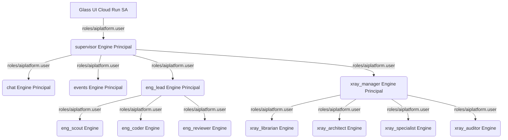

# Agentic Prism — Greenfield Implementation & Security Playbook

**Strategy:** Greenfield replica in a **new GCP project** (no migration of Reasoning Engine IDs, SQLite DBs, or Terraform state from a source project).

**Audience:** Engineers deploying from a **standalone `migration/` zip** only. The zip includes `app/` (agents, Glass UI, backend, infra, deploy scripts) plus this runbook, phase scripts, config templates, and artifacts.

**Prerequisites:** `gcloud`, `terraform`, Python 3.10+, `bash`, `curl` (optional `jq`).

---

## Table of Contents

1. [Standalone Pack Layout](#1-standalone-pack-layout)
2. [Phase Overview](#2-phase-overview)
3. [Bundle Transfer and First Setup](#3-bundle-transfer-and-first-setup)
4. [Architecture Recreated & Security Baseline](#4-architecture-recreated--security-baseline)
5. [Phase 0 — Pre-flight](#5-phase-0--pre-flight)
6. [Phase 1 — Infrastructure](#6-phase-1--infrastructure)
7. [Phase 2 — Reasoning Engines (12 agents)](#7-phase-2--reasoning-engines-12-agents)
8. [Phase 3 — Agent Gateway and Registry](#8-phase-3--agent-gateway-and-registry)
9. [Phase 4 — Glass UI (Cloud Run)](#9-phase-4--glass-ui-cloud-run)
10. [Phase 5 — Validation](#10-phase-5--validation)
11. [Phase 6 — IAP and HTTPS Load Balancer](#11-phase-6--iap-and-https-load-balancer)
12. [Resource Catalog](#12-resource-catalog)
13. [Configuration Reference](#13-configuration-reference)
14. [Migration Scripts Reference](#14-migration-scripts-reference)
15. [Optional One-Shot Deploy](#15-optional-one-shot-deploy)
16. [Troubleshooting](#16-troubleshooting)
17. [Sign-Off](#17-sign-off)
18. [Quick Reference](#18-quick-reference)

---

## 1. Standalone Pack Layout

Zip and move **only** `migration/`. You do **not** need a parent `agentic-prism-v3` repository at the destination.

```text
migration/                          ← your working directory (cd here)
├── IMPLEMENTATION.md               ← this guide
├── README.md, CHECKLIST.md, PACKAGING.md, SANITY_CHECK.md
├── config/
│   ├── versions.env.template       → copy to app/versions.env
│   ├── env.template                → copy to app/.env
│   └── migration.env.example       → copy to config/migration.env
├── scripts/                        ← phase runners (run from migration/)
│   ├── run-phased.sh
│   ├── phase0-preflight.sh … phase5-validate.sh
│   ├── grant-engine-telemetry-iam.sh
│   └── write-engine-ids-to-env.sh
├── artifacts/                      ← workbooks, IAM reference, IAP guide
├── output/                         ← logs created at deploy time (gitignored)
└── app/                            ← application root (REPO_ROOT)
    ├── deploy.sh, deploy-glass-ui.sh, deploy_all.sh
    ├── glass_ui_api.py, backend/, infra/
    ├── agentic-lens/agents/, agentic-lens/glass_ui/, agentic-lens/security/
    ├── scripts/, tests/
    └── versions.env, .env          ← you create these from config/templates
```

**Path rule:** Phase scripts set `REPO_ROOT` to `migration/app/` automatically when `app/deploy.sh` exists. All GCP deploy commands execute under `app/`. You run orchestration scripts from `migration/`.

---

## 2. Phase Overview

| Phase | Goal | Script (from `migration/`) | App command (under `app/`) | Log / output |
|-------|------|------------------------------|----------------------------|--------------|
| 0 | Auth, config, bundle check | `./scripts/phase0-preflight.sh` | — | `output/project-info-*.txt` |
| 1 | APIs, security, IAM, data | `./scripts/phase1-infra.sh` | `./infra/apply.sh` (orchestrated) | `output/phase1-infra.log` |
| 2 | 12 Reasoning Engines | `./scripts/phase2-agents.sh` | `./deploy.sh` | `output/phase2-deploy.log`, `output/engine-ids.env` |
| 3 | Agent Gateway / registry *(optional)* | `./scripts/phase3-agent-gateway.sh` | Skip if `SKIP_AGENT_GATEWAY=1` | `output/phases.status` or workbook |
| 4 | Glass UI Cloud Run | `./scripts/phase4-glass-ui.sh` | `./deploy-glass-ui.sh` | `output/phase4-glass-ui.log`, `output/glass-ui-url.txt` |
| 5 | pytest + smoke | `./scripts/phase5-validate.sh` | `pytest tests/`, smoke script | `output/phase5-*.log`, `output/smoke-report.json` |
| 6 | IAP + HTTPS LB | Manual | `artifacts/iap-load-balancer.md` | — |

**Run all phases with gates:**

```bash
cd migration
./scripts/run-phased.sh
```

Set `MIGRATION_AUTO_YES=1` to skip confirmation prompts (CI only).

---

## 3. Bundle Transfer and First Setup

### 3.1 What to zip

See [PACKAGING.md](./PACKAGING.md). Include `migration/` including `app/`. Exclude secrets and local build artifacts.

| Include | Exclude |
|---------|---------|
| `app/` (full bundle) | `app/.env`, `app/versions.env` |
| `config/*.template`, `config/migration.env.example` | `config/migration.env` (local) |
| `scripts/`, `artifacts/`, `*.md` | `output/` |
| | `app/.venv/`, `app/agentic-lens/.venv/` |
| | `**/.terraform/`, `*.db`, `node_modules/` |

**Maintainers:** refresh `app/` before zipping:

```bash
# From full repo checkout only:
./migration/sync-app-bundle.sh
```

### 3.2 Destination Setup (Required)

```bash
unzip agentic-prism-migration.zip -d /opt/deploy
cd /opt/deploy/migration

# Verify bundle
test -f app/deploy.sh && test -d app/agentic-lens/agents/supervisor && echo "Bundle OK"

chmod +x scripts/*.sh

cp config/versions.env.template app/versions.env
cp config/env.template app/.env
cp config/migration.env.example config/migration.env

# Edit PROJECT_ID, REGION, ORG_ID, skip flags
nano app/versions.env config/migration.env
```

### 3.3 Verify `REPO_ROOT`

```bash
cd migration
source scripts/_common.sh
echo "$REPO_ROOT"
# Must end with: .../migration/app
```

### 3.4 Documentation to use at destination

| Use this | Not this alone |
|----------|----------------|
| `migration/IMPLEMENTATION.md` | — |
| `artifacts/*.md` | — |
| `app/docs/DEPLOY.md` | `app/docs/README_v3.md` (has links to files not in bundle) |
| `CHECKLIST.md` | — |

---

## 4. Architecture Recreated & Security Baseline

```text
User → [IAP + HTTPS LB] → Cloud Run (ai-prism-agent-glass-ui)
     → Model Armor → Security Guard → Supervisor (Reasoning Engine)
     → Department engine → Response
```

| Department | Engine(s) | Backing services |
|------------|-----------|------------------|
| Supervisor | `supervisor` | Model Armor, routing |
| Chat | `chat` | Gemini |
| Engineering | `eng_lead` → `eng_scout`, `eng_coder`, `eng_quality_and_security_reviewer` | Gemini |
| Events | `events` | Vertex AI Search (Discovery Engine) |
| X-Ray | `xray_manager` → librarian, architect, specialist, auditor | Firestore `xray-db`, Secret Manager, Cloud Asset |

### 4.1 Security Architecture Baseline

All 12 Reasoning Engines must be deployed in compliance with the following project-level controls:

#### A. Dual Gateway Interception
Every agent's deployment spec must define both ingress and egress gateway endpoints:
*   **Ingress (`clientToAgentConfig`)**: Intercepts incoming prompts at the `main-ingress-agw` gateway, routing traffic through Model Armor shields to block adversarial injections.
*   **Egress (`agentToAnywhereConfig`)**: Intercepts outbound tool calls at the `main-egress-agw-v2` gateway, forcing routing through the Secure Web Proxy (SWP) to enforce domain allowlists.

#### B. SPIFFE-based Agent Identity
No shared service accounts. Every engine must be deployed with:
*   `identity_type = AGENT_IDENTITY`
*   Session user and platform access roles granted directly to the unique Reasoning Engine service principal (`principal://agents.global.org-873180247571.system.id.goog/...`).

#### C. Secure Telemetry & OpenTelemetry Setup
To satisfy the organizational `custom.enforceSecureAgentEngineConfig` policy, each Reasoning Engine must be deployed with the following exact environment variables in its `deploymentSpec.env`:
1.  `GOOGLE_CLOUD_AGENT_ENGINE_ENABLE_TELEMETRY = "true"`
2.  `OTEL_SEMCONV_STABILITY_OPT_IN = "gen_ai_latest_experimental"`
3.  `OTEL_INSTRUMENTATION_GENAI_CAPTURE_MESSAGE_CONTENT = "EVENT_ONLY"`

#### D. Peer-to-Peer IAM Communication Flow
To prevent `403 PERMISSION_DENIED: Permission 'aiplatform.sessions.create' denied` and peer resolution failures, we establish strict principal permissions mapping the multi-agent tree:



1.  **Glass UI Service Account** (`504643566830-compute@developer.gserviceaccount.com`):
    *   Needs `roles/aiplatform.user` and custom `reasoningEngineSessionUser` role to invoke the `supervisor` orchestrator and department heads directly via Vertex Client.
2.  **Supervisor & Brain Orchestrators** (`supervisor`, `chat`, `eng_lead`, `xray_manager` runtime principals):
    *   Need `roles/aiplatform.user` and `reasoningEngineSessionUser` bindings to execute downstream reasoning engines.
    *   Need `roles/serviceusage.serviceUsageConsumer` and `roles/cloudtrace.agent` to report spans and trace flows across the agent gateway.

---

## 5. Phase 0 — Pre-flight

**Objective:** Validate GCP project, authentication, configuration files, and org/gateway readiness.

**Run from:** `migration/`

```bash
./scripts/phase0-preflight.sh
```

### 5.1 What the script does

1. Confirms `app/deploy.sh` and `app/infra/apply.sh` exist (`require_repo`).
2. Creates `app/versions.env`, `app/.env`, `config/migration.env` from templates if missing.
3. Validates `PROJECT_ID` in `app/versions.env` (no `REPLACE_ME`).
4. Checks active `gcloud` account and Application Default Credentials.
5. Sets gcloud project; prints project number.
6. Resolves `ORG_ID` from project parent if not set.
7. Updates `app/.env` with `GCP_PROJECT_ID`, `GCP_PROJECT_NUMBER`, `GCP_LOCATION` via `app/scripts/update_env.py`.
8. Runs `scripts/collect-project-info.sh` → `output/project-info-*.txt`.

### 5.2 GCP project requirements

- [ ] Project created, billing enabled
- [ ] Deployer roles: Service Usage Admin, Vertex AI User/Admin, Cloud Run Admin, Cloud Build Editor, Secret Manager Admin, KMS Admin (if CMEK), IAM Admin (agent bindings)
- [ ] `REGION` in `app/versions.env` allowed by org policy (default `us-west1`)

### 5.3 Authentication (manual if needed)

```bash
gcloud auth login
gcloud auth application-default login
gcloud config set project YOUR_PROJECT_ID
gcloud auth application-default set-quota-project YOUR_PROJECT_ID
```

### 5.4 Configuration files

| File | Path | Required fields |
|------|------|-----------------|
| `versions.env` | `app/versions.env` | `PROJECT_ID`, `REGION`, `MODEL_VERSION`, `ORG_ID` |
| `.env` | `app/.env` | `GCP_PROJECT_ID`, `GCP_PROJECT_NUMBER`, `GCP_LOCATION` |
| `migration.env` | `config/migration.env` | `RUN_TELEMETRY`, `RUN_SETUP_KB`, skip flags |

### 5.5 Clean local state (optional)

Removes old `.env`, venvs, Terraform state, and agent engine configs **inside `app/`** only:

```bash
./app/scripts/clean_for_fresh_install.sh -f
```

### 5.6 Org policy and Agent Gateway (review before Phase 1)

- [artifacts/org-policy-preflight.md](./artifacts/org-policy-preflight.md)
- [artifacts/agent-gateway-workbook.md](./artifacts/agent-gateway-workbook.md)

### 5.7 Phase 0 exit criteria

- [ ] `source scripts/_common.sh` → `REPO_ROOT=.../migration/app`
- [ ] `gcloud projects describe PROJECT_ID` succeeds
- [ ] `ORG_ID` known (numeric)
- [ ] `app/versions.env` and `config/migration.env` edited
- [ ] Workbooks reviewed
- [ ] `output/project-info-*.txt` present (optional)

---

## 6. Phase 1 — Infrastructure

**Objective:** Enable APIs, security baseline, IAM, Firestore, Artifact Registry, optional telemetry/Events KB/RAG.

**Run from:** `migration/`

```bash
./scripts/phase1-infra.sh
```

**Creates:** `app/.venv` and `app/agentic-lens/.venv` if missing (via `ensure_venvs`).

### 6.1 What `phase1-infra.sh` runs (in order)

| Order | Infra step | Condition | Creates / configures |
|-------|------------|-----------|----------------------|
| 1 | 01–03 | always | APIs, Agent Engine bootstrap, optional `github-pat-token` |
| 2 | 04 | `SKIP_INFRA_MODEL_ARMOR≠1` | Model Armor Terraform (`security-medium`, `security-high`) |
| 3 | 05 | `SKIP_INFRA_CMEK≠1` | CMEK keys → appended to `app/versions.env` when script prints keys |
| 4 | 06–07 | always | Agent Identity IAM (12 agents), Firestore (`xray-db`) |
| 5 | 08 | `RUN_TELEMETRY=1` in `config/migration.env` | BigQuery `prism_telemetry.demo_usage_logs` |
| 6 | 09 | always | Artifact Registry `prism-glass-ui` |
| 7 | 10 | `RUN_SETUP_KB=1` | Events Discovery Engine data store |
| 8 | 11 | always | ADK patch (skips if `patch_adk_config_agent_utils.py` missing) |
| 9 | 12 | `SKIP_INFRA_VPC_SC=0` | VPC-SC Terraform in `app/agentic-lens/security/vpc_sc/` |
| 10 | 13–14 | always | RAG GCS bucket + Vertex RAG corpus |

**Log file:** `output/phase1-infra.log`

### 6.2 Skip flags (`config/migration.env`)

| Variable | Default in example | When to set `1` |
|----------|-------------------|-----------------|
| `SKIP_INFRA_MODEL_ARMOR` | `0` | Org already has equivalent Model Armor templates |
| `SKIP_INFRA_CMEK` | `0` | Org provides CMEK — copy keys into `app/versions.env` manually |
| `SKIP_INFRA_VPC_SC` | `1` | Org already has VPC-SC — extend perimeter per [artifacts/vpc-sc-ingress.md](./artifacts/vpc-sc-ingress.md) |
| `RUN_TELEMETRY` | `1` | Set `0` to skip BigQuery telemetry step |
| `RUN_SETUP_KB` | `1` | Set `0` to skip Events data store creation |

### 6.3 CMEK gate (critical before Phase 2)

After step 05, confirm `app/versions.env` contains:

```bash
AGENT_ENGINE_KMS_KEY_SUPERVISOR=projects/.../cryptoKeys/...
AGENT_ENGINE_KMS_KEY_CHAT=...
AGENT_ENGINE_KMS_KEY_ENGINEERING=...
AGENT_ENGINE_KMS_KEY_XRAY=...
AGENT_ENGINE_KMS_KEY_EVENTS=...
```

**Note:** `setup_cmek_per_department.sh` is not in the bundle; step 05 skips gracefully if missing. Use org-provided keys or add that script to `app/scripts/` and re-run step 05.

### 6.4 Events knowledge base

If `RUN_SETUP_KB=1`, copy `VERTEX_SEARCH_DATA_STORE_ID` from log output into `app/.env`. Indexing content is separate (`app/backend/setup_kb.py`). Greenfield store starts empty.

### 6.5 Manual alternative (from `migration/`)

```bash
cd migration
source config/migration.env 2>/dev/null || true
cd app
RUN_TELEMETRY=1 RUN_SETUP_KB=1 ./infra/apply.sh
```

Or staged: `./infra/apply.sh 01 05`, then `06 09`, etc. (see `app/infra/apply.sh` usage).

### 6.6 Phase 1 verification

```bash
source app/versions.env
gcloud model-armor templates list --project="$PROJECT_ID" --location="$REGION"
gcloud firestore databases list --project="$PROJECT_ID"
```

### 6.7 Phase 1 exit criteria

- [ ] `output/phase1-infra.log` has no blocking errors
- [ ] CMEK keys in `app/versions.env` (if required by org)
- [ ] Firestore database exists
- [ ] Artifact Registry repository exists
- [ ] Model Armor templates listable (or org equivalent documented)

---

## 7. Phase 2 — Reasoning Engines (12 agents)

**Objective:** Deploy all ADK agents to Vertex AI Agent Engine and wire engine IDs into `app/.env`.

**Run from:** `migration/`

```bash
./scripts/phase2-agents.sh
```

### 7.1 Agent roster

| # | Folder | Role |
|---|--------|------|
| 1 | `supervisor` | Intent routing |
| 2 | `chat` | Fallback / brand |
| 3 | `eng_lead` | Engineering orchestrator |
| 4 | `eng_scout` | Plan / research |
| 5 | `eng_coder` | Code / Terraform |
| 6 | `eng_quality_and_security_reviewer` | Security review loop |
| 7 | `events` | Vertex AI Search |
| 8 | `xray_manager` | X-Ray orchestrator |
| 9 | `xray_librarian` | Repo / secrets |
| 10 | `xray_architect` | Cloud state |
| 11 | `xray_specialist` | Policy inference / KB |
| 12 | `xray_auditor` | QA |

### 7.2 What `phase2-agents.sh` does

1. Runs `./scripts/validate-phase2-agent-sources.sh` (scout YAML, no `LlmAgent.from_config` in supervisor peers, cloudpickle pin).
2. Warns if CMEK keys missing (when `SKIP_INFRA_CMEK≠1`).
3. **Two-step deploy** (greenfield; no extra GCP resources):
   - **Step 1 — specialists (9):** `chat`, `events`, `eng_scout`, `eng_coder`, `eng_quality_and_security_reviewer`, `xray_librarian`, `xray_architect`, `xray_specialist`, `xray_auditor` with `SKIP_PREFLIGHT=1` (peer engine IDs do not exist yet).
   - **Merge:** `merge_peer_engine_env.py` + `merge_engineering_vertex_env.py` write peer IDs into `eng_lead` / `xray_manager` `.agent_engine_config.json`.
   - **Step 2 — orchestrators (3):** `eng_lead`, `xray_manager`, `supervisor` (normal preflight; peers must exist).
4. `./scripts/grant-engine-telemetry-iam.sh`
5. `./scripts/grant-reasoning-engine-identity-iam.sh` — **RE principal** `roles/aiplatform.user` (peer invoke)
6. **Refresh** `eng_lead` + `xray_manager` (merge peer env again, `SKIP_PREFLIGHT=1 ./deploy.sh eng_lead xray_manager`)
7. `./scripts/write-engine-ids-to-env.sh` → `app/.env` and `output/engine-ids.env`
8. `./scripts/verify-phase2-engines.sh` — must report 12/12

Log: `output/phase2-deploy.log`. Parallelism: `DEPLOY_PARALLEL` (default 8).

**Prerequisite:** Delete any failed/orphan Reasoning Engines in Console before re-run (clean project).

**Preflight (sources):** From `migration/`, run `./scripts/validate-phase2-agent-sources.sh` after editing agents in the repo (or after `./sync-app-bundle.sh`). Fails fast if `eng_scout/root_agent.yaml` is missing or supervisor peers still use `LlmAgent.from_config`.

**ADC quota project:** Before deploy, run `gcloud auth application-default set-quota-project agentic-lens` (avoids transient `403` / wrong project number).

**Duration:** 30–90+ minutes. Allow **15+ min** for `supervisor` alone (`ADK_DEPLOY_TIMEOUT=1200` set in `phase2-agents.sh`).

### 7.3 Manual alternative

```bash
cd migration/app
source ../config/migration.env 2>/dev/null || true
export DEPLOY_PARALLEL=8

# Step 1
SKIP_PREFLIGHT=1 ./deploy.sh chat events eng_scout eng_coder eng_quality_and_security_reviewer \
  xray_librarian xray_architect xray_specialist xray_auditor
agentic-lens/.venv/bin/python scripts/merge_peer_engine_env.py .
agentic-lens/.venv/bin/python scripts/merge_engineering_vertex_env.py .

# Step 2
./deploy.sh eng_lead xray_manager supervisor

cd ..
./scripts/grant-engine-telemetry-iam.sh
./scripts/write-engine-ids-to-env.sh
./scripts/verify-phase2-engines.sh
```

### 7.4 Required `app/.env` variables after Phase 2

```bash
AGENTIC_LENS_SUPERVISOR_ENGINE=projects/PROJECT_NUMBER/locations/REGION/reasoningEngines/ID
SUPERVISOR_ENGINE_ID=          # same as above
CHAT_ENGINE_ID=...
ENG_ENGINE_ID=...              # eng_lead
EVENTS_ENGINE_ID=...
XRAY_ENGINE_ID=...             # xray_manager
```

**Recommended (Engineering squad):**

```bash
AGENTIC_LENS_ENGINE_SCOUT=...
AGENTIC_LENS_ENGINE_CODER=...
AGENTIC_LENS_ENGINE_QUALITY_AND_SECURITY_REVIEWER=...
```

### 7.5 Phase 2 Verification

```bash
cd migration
./scripts/verify-phase2-engines.sh
```

Or single agent:

```bash
cd migration/app
agentic-lens/.venv/bin/python scripts/get_agent_engine_id.py supervisor
```

Console: **Vertex AI → Agent Engine → Reasoning engines** — 12 engines in `REGION`.

Record completion in **`LEDGER.md`** and **`CHECKLIST.md`** (or `output/sign-off.md`).

### 7.6 Phase 2 exit criteria

- [ ] `./scripts/validate-phase2-agent-sources.sh` passed (before deploy)
- [ ] 12/12 agents deployed (`output/phase2-deploy.log`)

- [ ] `grant-engine-telemetry-iam.sh` completed
- [ ] `write-engine-ids-to-env.sh` completed
- [ ] `./scripts/verify-phase2-engines.sh` — 12/12 OK
- [ ] `app/.env` has `AGENTIC_LENS_SUPERVISOR_ENGINE`, `SUPERVISOR_ENGINE_ID`, department + engineering squad IDs
- [ ] Engines **Active** in Console
- [ ] Phase 2 sign-off in `LEDGER.md`

---

## 8. Phase 3 — Agent Gateway and Registry

**Objective:** Align with org **Agent Gateway** and **Agent Registry** (not automated in application code).

### 8.0 Skip (Direct Connectivity) — `agentic-lens` default

This migration uses **direct** Reasoning Engine connectivity (original Prism deploy path). No gateway wiring in application code.

In `migration/config/migration.env`:

```bash
SKIP_AGENT_GATEWAY=1
```

Then Phase 3 is a no-op and **`run-phased.sh` proceeds to Phase 4** without a confirmation gate:

```bash
./scripts/phase3-agent-gateway.sh   # logs skip, writes phases.status
./scripts/phase4-glass-ui.sh        # next
```

Traffic: **Browser → Cloud Run (Glass UI) → Vertex Reasoning Engine API** (`app/backend/agent_engine_client.py`). Model Armor runs on Cloud Run before the supervisor engine call.

### 8.0.1 When not skipping

**Run from:** `migration/`

```bash
# migration.env: SKIP_AGENT_GATEWAY=0
./scripts/phase3-agent-gateway.sh
```

Complete [artifacts/agent-gateway-workbook.md](./artifacts/agent-gateway-workbook.md).

### 8.1 Model A — Tool Governance (Recommended First)

- Glass UI → Reasoning Engines directly (`app/backend/agent_engine_client.py`).
- Agent Gateway governs **tool egress** (GitHub, `*.googleapis.com`, Discovery Engine, etc.).

### 8.2 Model B — Client-to-Agent Gateway

- UI traffic through gateway URL — Implemented via the "Query via MCP" approach. All backend engine queries (Supervisor and Chat) are now routed through the edge Ingress Gateway (`main-ingress-agw`) virtual proxy endpoint (`/agentGateways/main-ingress-agw/agents/<agent_id>/a2a`) using direct A2A/MCP HTTP calls. This triggers the edge Model Armor templates on all incoming prompts natively before execution.
*   **Action**: Discovered that all virtual proxy A2A request paths targeting `.../agentGateways/main-ingress-agw/agents/{agent_id}/a2a` returned `404 Not Found` across all API versions and agent identifiers.
*   **Action**: Confirmed that the `404 Not Found` triggers the client's built-in fallback path to standard control-plane SDK queries, which executes the query successfully but bypassed Model Armor because the `security_level` was not passed properly into the control plane via standard SDK kwargs.
*   **Action**: Patched `_stream_query_resolving_engine_session` in `agent_engine_client.py` to explicitly log `security_level` and `armor_enabled` and pass them into the `stream_query` kwargs so that the Vertex AI platform interceptor natively invokes Model Armor on the SDK fallback path.
*   **Outcome**: Client A2A integrations successfully deployed and running. A2A path resolution returns 404, but the SDK fallback is now securely enforcing Model Armor policies.
*   **Action**: Identified that the Glass UI was missing the required Reasoning Engine mapping environment variables (`AGENTIC_LENS_SUPERVISOR_ENGINE`, `SUPERVISOR_ENGINE_ID`, etc.) inside the container spec, causing `is_agent_engine_configured()` to fail and return a `503 Service Unavailable / Engine Offline` status. Sourced the variables from `agentic-lens/app/.env` and redeployed to Cloud Run. The `/api/healthz?deep=1` check now passes with `HTTP 200`.
*   **Action**: Diagnosed `[MODEL ARMOR ERROR / BYPASS]: Scan error (region us-central1): HTTPSConnectionPool Max retries exceeded` failures. Discovered that the global `patched_getaddrinfo` in `glass_ui_api.py` was redirecting *all* `googleapis.com` API requests to `240.0.0.2` (the Gateway IP). Since the Gateway only accepts gRPC MCP traffic, REST/HTTPS requests to Model Armor timed out.
*   **Action**: Modified `patched_getaddrinfo` to exclude `modelarmor` from the gateway-bound rewrite, allowing Model Armor client calls to resolve and route directly through Private Google Access. Started the Cloud Run build/deploy sequence (`task-3857`) with this fix active.

### 8.3 Registry (Minimum)

Register: `supervisor`, `chat`, `eng_lead`, `events`, `xray_manager`.

### 8.4 Phase 3 exit criteria

**If `SKIP_AGENT_GATEWAY=1` (direct connectivity):**

- [x] Documented in `LEDGER.md` — gateway deferred
- [x] No `AGENT_GATEWAY_*` required in `app/.env`
- [ ] Proceed to [Phase 4](#9-phase-4--glass-ui-cloud-run)

**If gateway enabled (`SKIP_AGENT_GATEWAY=0`):**

- [ ] Gateway resource ID in `artifacts/resource-inventory.csv`
- [ ] Tool policies configured (Model A)
- [ ] Agents registered (if required by org)
- [ ] VPC-SC / gateway allowlists include Reasoning Engine SA + Storage + Artifact Registry

---

## 9. Phase 4 — Glass UI (Cloud Run)

**Objective:** Build and deploy Cloud Run service `ai-prism-agent-glass-ui`.

**Run from:** `migration/`

```bash
./scripts/phase4-glass-ui.sh
```

### 9.1 Prerequisites

- [x] Phase 2 engine IDs in `app/.env`
- [ ] Artifact Registry from Phase 1
- [ ] Cloud Build + Run permissions for deployer

### 9.2 What `phase4-glass-ui.sh` does

1. Sources `app/.env` and `app/versions.env`.
2. Sets `GCP_PROJECT_ID`, `REGION`, engine env vars.
3. Honors `GLASS_UI_ALLOW_UNAUTHENTICATED` from `config/migration.env`.
4. Runs `app/deploy-glass-ui.sh` → `output/phase4-glass-ui.log`.
5. Runs `scripts/verify-health.sh` → `output/healthz-deep.json`, `output/glass-ui-url.txt`.

### 9.3 Manual Alternative

```bash
cd migration
source app/versions.env
set -a; source app/.env; set +a
export GCP_PROJECT_ID="$PROJECT_ID" REGION="$REGION"
# Dev only: export GLASS_UI_ALLOW_UNAUTHENTICATED=1
cd app && ./deploy-glass-ui.sh
cd .. && ./scripts/verify-health.sh
```

### 9.4 Service Specification

| Setting | Value |
|---------|-------|
| Name | `ai-prism-agent-glass-ui` |
| Image | `REGION-docker.pkg.dev/PROJECT_ID/prism-glass-ui/ai-prism-agent-glass-ui` |
| Memory / CPU | 8Gi / 4 |
| Request timeout | 1800s (`GLASS_UI_CLOUD_RUN_TIMEOUT_S`) |
| Min instances | 1 |
| Auth (default) | Private; IAP SA `roles/run.invoker` |

### 9.5 Health Check

```bash
./scripts/verify-health.sh
cat output/glass-ui-url.txt
curl -sS "$(cat output/glass-ui-url.txt)/healthz?deep=1"
```

Expect HTTP 200 and supervisor configured.

### 9.6 Phase 4 exit criteria

- [ ] Cloud Run service deployed
- [ ] `/healthz?deep=1` healthy
- [ ] Test UI query returns non-`[Mock]` response
- [ ] Auth mode documented (IAP vs dev public)

---

## 10. Phase 5 — Validation

**Objective:** Automated tests and live smoke against Cloud Run.

**Run from:** `migration/`

```bash
./scripts/phase5-validate.sh
```

### 10.1 What `phase5-validate.sh` does

| Step | Condition | Action |
|------|-----------|--------|
| pytest | `RUN_PYTEST=1` | `cd app` → `.venv/bin/pytest tests/ -q` → `output/phase5-pytest.log` |
| smoke | `RUN_SMOKE=1` | `app/scripts/smoke_glass_ui_departments.py` → `output/smoke-report.json` |

Uses `output/glass-ui-url.txt` or discovers Cloud Run URL automatically.

### 10.2 Manual pytest

```bash
cd migration/app
python3 -m venv .venv && .venv/bin/pip install -r requirements.txt -r requirements-dev.txt
.venv/bin/pytest tests/ -q
```

### 10.3 Manual Smoke

```bash
cd migration
export GLASS_UI_URL="$(cat output/glass-ui-url.txt)"
# If behind IAP:
# export IAP_OAUTH_CLIENT_ID='....apps.googleusercontent.com'
python3 app/scripts/smoke_glass_ui_departments.py --profile smoke --report output/smoke-report.json
python3 app/scripts/smoke_glass_ui_departments.py --profile full --report output/smoke-report-full.json
```

Scenarios: `app/tests/fixtures/department_scenarios.json`.

### 10.4 Manual UI Checks

- [ ] Model Armor toggle blocks unsafe prompt
- [ ] Omnibar demo scenarios per department
- [ ] Live System Logs: Armor → Guard → Supervisor → Department

### 10.5 Cloud Logging

```text
jsonPayload.event=("query_start" OR "supervisor_routing_done" OR "department_call_done" OR "query_done")
```

### 10.6 Phase 5 exit criteria

- [ ] `RUN_PYTEST=1` → tests pass
- [ ] `RUN_SMOKE=1` → smoke profile passes
- [ ] Manual spot-check OK
- [ ] Gateway audit log (if Phase 3 Model A)

---

## 11. Phase 6 — Production IAM, IAP, and HTTPS Load Balancer

**Objective:** Harden Reasoning Engine identity IAM for peer calls; configure HTTPS LB + OIDC IAP.

### 11.0 Reasoning Engine identity IAM (Required)

Terraform (Phase 1 step 06) binds `principal://.../agents/agentic_lens_*`.  
Runtime **AGENT_IDENTITY** uses `principal://.../reasoningEngines/<id>` from `deploy.sh`.

Without RE-principal `roles/aiplatform.user`, eng_lead → eng_coder fails with `403 reasoningEngines.get`.

```bash
cd migration
./scripts/grant-reasoning-engine-identity-iam.sh
# If eng_lead deployed before scout existed:
cd app && agentic-lens/.venv/bin/python3 scripts/merge_peer_engine_env.py .
SKIP_PREFLIGHT=1 ./deploy.sh eng_lead xray_manager
```

Or: `./scripts/phase6-production-iam.sh`

### 11.1 IAP and HTTPS Load Balancer (Manual)

**Objective:** Production HTTPS access with Identity-Aware Proxy.

**Manual** — full commands in [artifacts/iap-load-balancer.md](./artifacts/iap-load-balancer.md).

**Run gcloud from `migration/`** with `app/versions.env` sourced:

```bash
cd migration
source app/versions.env
```

### 11.2 Serverless NEG

```bash
gcloud compute network-endpoint-groups create glass-ui-neg \
  --region="${REGION}" \
  --network-endpoint-type=serverless \
  --cloud-run-service=ai-prism-agent-glass-ui \
  --project="${PROJECT_ID}"
```

### 11.3 Backend Service

```bash
gcloud compute backend-services create glass-ui-backend \
  --global \
  --load-balancing-scheme=EXTERNAL_MANAGED \
  --project="${PROJECT_ID}"

gcloud compute backend-services add-backend glass-ui-backend \
  --global \
  --network-endpoint-group=glass-ui-neg \
  --network-endpoint-group-region="${REGION}" \
  --project="${PROJECT_ID}"
```

**Set backend timeout ≥ 1800 seconds** (match Cloud Run).

### 11.4 URL Map, Certificate, Forwarding Rule

Use Console: **Network Services → Load balancing → Create HTTP(S) load balancer** (managed cert for your hostname).

### 11.5 IAP Activation

1. **Security → Identity-Aware Proxy** → enable on backend.
2. Grant `roles/iap.httpsResourceAccessor` to users/groups.

### 11.6 Cloud Run Invoker for IAP

```bash
PN=$(gcloud projects describe "${PROJECT_ID}" --format='value(projectNumber)')
IAP_SA="service-${PN}@gcp-sa-iap.iam.gserviceaccount.com"

gcloud run services add-iam-policy-binding ai-prism-agent-glass-ui \
  --region="${REGION}" \
  --project="${PROJECT_ID}" \
  --member="serviceAccount:${IAP_SA}" \
  --role="roles/run.invoker"
```

(`app/deploy-glass-ui.sh` adds this when not using public invoke.)

### 11.7 Smoke with IAP

```bash
export GLASS_UI_URL="https://your-hostname.example.com"
export IAP_OAUTH_CLIENT_ID="....apps.googleusercontent.com"
cd migration
python3 app/scripts/smoke_glass_ui_departments.py --profile full --report output/smoke-iap-report.json
```

### 11.8 Phase 6 exit criteria

- [ ] UI reachable only via IAP (no `allUsers` on Run)
- [ ] LB backend timeout ≥ 1800s
- [ ] Smoke with IAP token passes
- [ ] Legacy `agentic-lens-ui` removed if it existed

### 11.10 [STABILIZATION] Ingress vs Egress Gateway Protection & Registry Hardening
During system verification, key security architecture patterns were verified and configured regarding native Vertex AI gateway enforcement:
1. **Dual-Gateway IAP Protection**: The Custom IAP Authorization Policy (`gemini-corp-iap-policy`) has been configured to target **both the Ingress Gateway (`main-ingress-agw`) and Egress Gateway (`main-egress-agw-v2`)** using absolute numeric project resource IDs. By binding IAP directly to the Ingress Gateway edge, privileged console routes (such as the Vertex AI Playground) that bypass standard API paths are intercepted and blocked at the network entry boundary when unable to present valid IAP token headers.
2. **Ingress Registry Binding**: The regional Agent Registry (`//agentregistry.googleapis.com/projects/agentic-ai-lens/locations/us-central1`) has been successfully attached to the Ingress Gateway (`main-ingress-agw`) to enable native Client-to-Agent name resolution and request proxying for all 12 deployed reasoning engines.
3. **Egress Gateway Policy**: Bound directly inside the runtime containers, the Egress Gateway consistently audits and blocks outbound connections (enforcing allowed API lists) across both API external and Console Playground calls.

### 11.11 [OBSERVABILITY] Terraform Observability & Debugging Dashboards
To support continuous diagnostics of Gateway connections and policy actions, a Terraform module was deployed to provision two custom Cloud Monitoring dashboards:
1. **Agent Gateway Observability Dashboard (`Agent Gateway Observability`)**: Automatically aligned in a 2-column layout. Tracks blocked egress bytes, Model Armor user sanitization blocks, requesting Cloud Run latency (99th percentile), and HTTP 4xx/5xx error rates grouped by response code class.
2. **Authorization Debugging Dashboard (`Agent Platform: Authorization Debugging`)**: Projections configured dynamically inside a 48-column `mosaicLayout` using `templatefile()` project variable interpolation. It queries unified Log Analytics tables (`_Default._AllLogs`) via Ops Analytics SQL to join, regex-extract, and display allowed/denied target request rates, PyPI/GitHub unregistered outbound blocks, and baseline IAM failures directly corresponding to the active reasoning engine IDs.
3. **Usage**: The module is defined under `modules/observability/` and can be called directly from your root Terraform configurations.

---

## 12. Resource Catalog

Track in [artifacts/resource-inventory.csv](./artifacts/resource-inventory.csv).

| Resource Type | Name / Pattern | Phase |
|---------------|----------------|-------|
| Reasoning Engine | 12 agents | 2 |
| Cloud Run | `ai-prism-agent-glass-ui` | 4 |
| Artifact Registry | `prism-glass-ui` | 1 |
| Firestore DB | `xray-db` | 1 |
| Collection | `iam_knowledge_base` | runtime |
| Secret | `github-pat-token` (optional) | 1 |
| Model Armor | `security-medium`, `security-high` | 1 |
| KMS | `AGENT_ENGINE_KMS_KEY_*` | 1 |
| BigQuery | `prism_telemetry.demo_usage_logs` | 1 (optional) |
| Discovery Engine | Events data store | 1 (optional) |
| GCS / RAG | RAG bucket + corpus | 1 |
| Agent Gateway | org resource | 3 |
| HTTPS LB + IAP | production URL | 6 |

---

## 13. Configuration Reference

### 13.1 `app/versions.env`

| Variable | Required | Purpose |
|----------|----------|---------|
| `PROJECT_ID` | Yes | GCP project |
| `REGION` | Yes | Vertex / Run / KMS |
| `ORG_ID` | Yes | Agent Identity IAM |
| `MODEL_VERSION` | Yes | Injected into agent.yaml at deploy |
| `ADK_VERSION` | No | Documented default `1.18` |
| `AGENT_ENGINE_KMS_KEY_*` | If CMEK required | Five department keys |

### 13.2 `app/.env`

| Variable | Required | Purpose |
|----------|----------|---------|
| `GCP_PROJECT_ID` | Yes | Same as `PROJECT_ID` |
| `GCP_PROJECT_NUMBER` | Yes | Numeric project number |
| `GCP_LOCATION` | Yes | Same as `REGION` |
| `AGENTIC_LENS_SUPERVISOR_ENGINE` | Yes for live UI | Full resource name |
| `CHAT_ENGINE_ID`, `ENG_ENGINE_ID`, `EVENTS_ENGINE_ID`, `XRAY_ENGINE_ID` | Yes for routing | Department engines |
| `VERTEX_SEARCH_DATA_STORE_ID` | Events | From step 10 |
| `GLASS_UI_LOGS_FIRESTORE_DATABASE` | No | Cross-instance live logs |
| `IAP_OAUTH_CLIENT_ID`, `GLASS_UI_URL` | Phase 5/6 | Smoke behind IAP |

### 13.3 `config/migration.env`

| Variable | Default | Purpose |
|----------|---------|---------|
| `RUN_TELEMETRY` | `1` | Run infra step 08 |
| `RUN_SETUP_KB` | `1` | Run infra step 10 |
| `SKIP_INFRA_MODEL_ARMOR` | `0` | Skip step 04 |
| `SKIP_INFRA_CMEK` | `0` | Skip step 05 |
| `SKIP_INFRA_VPC_SC` | `1` | Skip step 12 |
| `GLASS_UI_ALLOW_UNAUTHENTICATED` | `0` | Public Cloud Run (dev) |
| `RUN_PYTEST` | `1` | Phase 5 unit tests |
| `RUN_SMOKE` | `1` | Phase 5 smoke |
| `SMOKE_PROFILE` | `smoke` | `smoke` or `full` |
| `DEPLOY_PARALLEL` | `8` | `deploy.sh` parallelism |
| `REPO_ROOT` | auto | Override only if needed |

---

## 14. Migration Scripts Reference

All paths relative to `migration/`.

| Script | Purpose |
|--------|---------|
| `run-phased.sh` | Phases 0–5 with confirmation gates |
| `phase0-preflight.sh` | Auth, config, project info |
| `phase1-infra.sh` | Orchestrates `app/infra/apply.sh` with skips |
| `phase2-agents.sh` | `app/deploy.sh` + IAM + engine IDs |
| `phase3-agent-gateway.sh` | Gateway workbook checklist |
| `phase4-glass-ui.sh` | `app/deploy-glass-ui.sh` + health |
| `phase5-validate.sh` | pytest + smoke |
| `grant-engine-telemetry-iam.sh` | Trace/monitoring SA roles |
| `grant-reasoning-engine-identity-iam.sh` | RE principal `aiplatform.user` (peer invoke) |
| `phase6-production-iam.sh` | Phase 6 IAM runner + IAP doc pointer |
| `write-engine-ids-to-env.sh` | Populate `app/.env` from engines |
| `verify-health.sh` | `/healthz` checks |
| `collect-project-info.sh` | Snapshot project metadata |
| `_common.sh` | `REPO_ROOT`, paths, `ensure_venvs` |
| `sync-app-bundle.sh` | **Maintainers:** refresh `app/` from full repo |

---

## 15. Optional One-Shot Deploy

Inside `app/` only (after `app/versions.env` exists):

```bash
cd migration/app
RUN_TELEMETRY=1 RUN_SETUP_KB=1 ./deploy_all.sh
# Then configure engine IDs, deploy-glass-ui.sh, etc.
```

Prefer phased `migration/scripts/` for first greenfield (clearer gates and logs).

---

## 16. Troubleshooting

| Symptom | Action |
|---------|--------|
| `REPO_ROOT` wrong / missing `app/deploy.sh` | Re-unzip pack; verify `test -f app/deploy.sh` |
| Phase script can't find `versions.env` | `cp config/versions.env.template app/versions.env` |
| Agent deploy code 13 | `app/docs/DEPLOY.md`; retry `cd app && ./deploy.sh` |
| Engine fails to start | Logs Explorer → Reasoning Engine; `google-adk>=1.5.0`, `cloudpickle<3` |
| `eng_scout` missing in Console | Ensure `agents/eng_scout/root_agent.yaml` exists; `agent.py` loads `root_agent.yaml` (not `config.yaml` only). Re-run `./scripts/validate-phase2-agent-sources.sh`. |
| `supervisor` `AttributeError: from_config` | Supervisor imports `peer_agents.chat` / `xray_manager` `agent.py` at startup — use `config_agent_utils.from_config`, not `LlmAgent.from_config`. Sync bundle + redeploy supervisor. |
| Failed engine invisible in Console | Normal — use engine ID from deploy log in Logs Explorer (`resource.labels.reasoning_engine_id`). |
| `supervisor_configured: false` | Re-run `scripts/write-engine-ids-to-env.sh`; redeploy Glass UI |
| `[Mock]` in UI | Engine env vars missing on Cloud Run — redeploy phase 4 with `app/.env` exported |
| 504 from browser | IAP/LB timeout < 1800s — raise backend timeout |
| VPC-SC blocked deploy | [artifacts/vpc-sc-ingress.md](./artifacts/vpc-sc-ingress.md) |
| IAM 403 sessions | Re-run infra step 06; `app/agentic-lens/security/iam/` |
| Trace export errors | `scripts/grant-engine-telemetry-iam.sh` |
| `AUTH_403` / `reasoningEngines.get` on Coder/Scout from Engineering | `scripts/grant-reasoning-engine-identity-iam.sh`; redeploy `eng_lead` after `merge_peer_engine_env.py` |
| `ENGINE_NOT_CONFIGURED` for scout | Redeploy `eng_lead` after scout engine exists + merge peer env |
| CMEK step skipped | Add `setup_cmek_per_department.sh` to `app/scripts/` or set org keys in `app/versions.env` |
| ADK patch skipped | Optional; add `patch_adk_config_agent_utils.py` to `app/scripts/` if deploy fails |

---

## 17. Sign-Off

Complete [CHECKLIST.md](./CHECKLIST.md). Record approvals in [LEDGER.md](./LEDGER.md) per phase. Archive under `output/`:

- `project-info-*.txt`
- `phase1-infra.log`
- `phase2-deploy.log`
- `engine-ids.env`
- `glass-ui-url.txt`
- `smoke-report.json`

---

## 18. Quick Reference

```bash
cd migration

# 1. Setup
test -f app/deploy.sh && echo "Bundle OK"
cp config/versions.env.template app/versions.env
cp config/env.template app/.env
cp config/migration.env.example config/migration.env
# EDIT app/versions.env config/migration.env

chmod +x scripts/*.sh

# 2. Phased deploy
./scripts/run-phased.sh
```
